# Architecture

## System overview

The application is a React 19 and TypeScript single page application (`frontend/src`) backed by an ASP.NET Core Web API targeting .NET 10 (`backend`). SQL Server is the system of record. The backend uses Dapper and Microsoft.Data.SqlClient; every repository operation names a stored procedure. Exchange rates come from ExchangeRate-API through a typed `HttpClient`.

The frontend owns route presentation and session state. `frontend/src/api/axiosInstance.ts` sends JSON requests, attaches the in-memory access token, includes the refresh cookie, and attempts one refresh/retry after a 401. The API owns authorization, validation, business behavior, persistence orchestration, and currency conversion. The database enforces relational constraints and implements data operations in scripts under [`../database`](../database/).

```mermaid
flowchart LR
  U[Browser user] --> R[React routes and pages]
  R --> A[frontend/src/api modules]
  A --> X[Axios interceptors and auth store]
  X -->|Bearer access token; refresh cookie| C[ASP.NET Core controllers]
  C --> M[GlobalExceptionMiddleware]
  M --> J[JWT authentication and authorization]
  J --> P[PasswordChangeMiddleware]
  P --> S[Application services]
  S --> D[Dapper repositories]
  D -->|Stored procedure calls| Q[(SQL Server)]
  S -->|Product reads| K[CachedExchangeRateService]
  K -->|cache miss| H[Typed HttpClient / ExchangeRateService]
  H --> E[ExchangeRate-API]
  K --> S
  S --> C
  C -->|HTTP response / validation errors| X
```



## Backend responsibilities and request flow

- `backend/Controllers` exposes routes. `ProductsController`, `SuppliersController`, and `UsersController` map service outcomes to HTTP responses. Controllers marked `[ApiController]` use ASP.NET Core model validation and return field keyed validation errors for invalid request models.
- `backend/Services` contains application rules. `ProductService` retrieves products and converts supplier currency prices to LKR for responses. `AuthService` verifies password hashes, issues JWT access tokens, and manages refresh token rotation. User and supplier services coordinate their repositories.
- `backend/Repositories` maps method inputs to Dapper parameters and calls named stored procedures with `CommandType.StoredProcedure`. `ProductRepository.GetPagedAsync` uses `QueryMultipleAsync` to read the count and page result sets from `dbo.usp_Products_GetPaged`.
- `backend/Configuration/DatabaseConfig.cs` registers a scoped SQL connection from `ConnectionStrings:DefaultConnection`.
- `database/schema/001_create_tables.sql` creates the four tables and indexes. Files `database/procedures/001` through `007` define database operations; `database/seed/001_seed_data.sql` adds sample suppliers and products.

## Authentication and authorization

`AuthController` allows anonymous login, refresh, and logout. Successful login and refresh return an access-token session and set `keells-refresh` as an HttpOnly cookie scoped to `/api/auth`; it uses `SameSite=Lax` and sets `Secure` when the request is HTTPS. The frontend stores access-token session data in `authStore` and sends it as a Bearer token. Refresh token values are persisted as SHA-256 hashes by the authentication service/repository, and `dbo.usp_RefreshTokens_Rotate` rotates a token transactionally and links the old row to its replacement.

In `Program.cs`, JWT Bearer validation checks issuer, audience, signing key, and lifetime with 30 seconds of clock skew. `ProductsController` and `SuppliersController` require an authenticated user at controller level. Product deletion and supplier create/update/deactivate/reactivate require the `Admin` role; `UsersController` requires `Admin` for all actions. Product creation and update require authentication but are not restricted by an Admin role in the controller. Stored procedures also check actor status/role for operations whose SQL declares those checks.

The first administrator is created by `tools/AdminSetup` through `dbo.usp_Users_BootstrapFirstAdmin`; its SQL requires an empty Users table and sets `MustChangePassword`. `PasswordChangeMiddleware` runs after authentication and checks current user state through `IAuthRepository.GetUserByIdAsync` for authenticated requests. It blocks most requests with 403 while a password change is required, and exempts `/api/auth/login` and `/api/auth/change-password`. The frontend also redirects a logged-in user to `/change-password`; this is a UI aid, while the API middleware enforces the requirement.

## Validation and errors

Request DTOs use `System.ComponentModel.DataAnnotations`. `SkuAttribute` in `backend/Validation/SkuAttribute.cs` permits ASCII letters, digits, hyphens, and underscores; `[Required]` handles missing/empty SKU separately. Product DTOs constrain text lengths, supplier IDs to at least 1, and `UnitPrice` to 0 through 99,999,999,999,999.9999. Supplier DTOs validate a three-letter currency code, email format, and field lengths. `ProductQueryRequest` constrains page number/size, optional filters, and allowed sort values.

With `[ApiController]`, invalid DTOs are rejected before the action and returned as HTTP 400 validation problem details with errors keyed by field. Controllers also map explicit outcomes: 201 for creates, 200 for reads/updates, 204 for product soft-delete, 400 for invalid input, 401 for unauthenticated or invalid token sessions, 403 for forbidden role/password-change/origin checks, 404 for missing records, 409 for duplicate username/SKU, and 503 for unhealthy database status. Other unhandled exceptions pass through `GlobalExceptionMiddleware`, which logs the exception and returns a generic 500 response without exposing exception details.

## Middleware and endpoint pipeline

`Program.cs` installs the pipeline in this order:

1. `GlobalExceptionMiddleware` catches downstream exceptions.
2. Swagger and Swagger UI are added only in Development.
3. HTTPS redirection.
4. `FrontendPolicy` CORS using `Cors:FrontendOrigins` (default localhost origin).
5. JWT authentication populates `HttpContext.User`.
6. `PasswordChangeMiddleware` checks current password-change status for authenticated users.
7. Authorization evaluates `[Authorize]` and role requirements.
8. Mapped controllers execute.

## Product currency conversion

The provider returns conversion rates relative to USD. `ExchangeRateService` reads `ExchangeRateApi:ApiKey`, calls `https://v6.exchangerate-api.com/v6/{key}/latest/USD`, requires a successful HTTP status and a response with `result == success`, `base_code == USD`, and a nonempty `conversion_rates` map. Its typed client has a 10-second timeout. `CachedExchangeRateService` caches the complete response in `IMemoryCache` under `ExchangeRates.USD` for 30 minutes. It does not implement stale-on-error fallback: on a cache miss/expiry, provider errors propagate to global exception handling.

For a product whose supplier currency has provider rate `currencyPerUsd`, `ProductService` calculates `lkrPerCurrency = lkrPerUsd / currencyPerUsd`, multiplies by `UnitPrice`, and rounds the LKR amount to two decimal places using `MidpointRounding.AwayFromZero`. It also returns the applied rate and provider update timestamp. An invalid timestamp, missing/nonpositive LKR rate, or missing/nonpositive product-currency rate causes an `InvalidOperationException`. Empty product pages and missing individual products do not perform a rate lookup.

## Representative request sequence

```mermaid
sequenceDiagram
  actor User
  participant UI as ProductsPage / productApi
  participant AX as axiosInstance
  participant API as ProductsController
  participant JWT as JWT authentication
  participant PW as PasswordChangeMiddleware
  participant Authz as Authorization
  participant S as ProductService
  participant Repo as ProductRepository
  participant DB as SQL Server
  participant Cache as CachedExchangeRateService
  participant FX as ExchangeRateService / typed HttpClient
  participant Provider as ExchangeRate-API

  User->>UI: Open product list
  UI->>AX: GET /api/products with query parameters
  AX->>API: Request with Bearer token and refresh cookie
  API->>JWT: Validate issuer, audience, signature, lifetime
  JWT-->>API: Authenticated principal
  API->>PW: Check MustChangePassword via IAuthRepository
  PW-->>API: Continue when password change is not required
  API->>Authz: Apply [Authorize] policy
  Authz-->>API: Authenticated user may access products
  API->>API: Validate ProductQueryRequest (ApiController)
  API->>S: GetPagedAsync(request)
  S->>Repo: GetPagedAsync(request)
  Repo->>DB: dbo.usp_Products_GetPaged (QueryMultiple)
  DB-->>Repo: Total count and product rows
  Repo-->>S: Items and total count
  opt At least one product
    S->>Cache: GetLatestRatesAsync()
    alt Cache hit
      Cache-->>S: Cached USD rates and timestamp
    else Cache miss or expiry
      Cache->>FX: GetLatestRatesAsync()
      FX->>Provider: GET latest/USD
      Provider-->>FX: USD conversion rates
      FX-->>Cache: Validated provider response
      Cache-->>S: Rates (then cached for 30 minutes)
    end
    S->>S: Convert supplier prices to LKR; round to two decimals
  end
  S-->>API: Products and total count
  API-->>AX: 200 JSON page response
  AX-->>UI: Render products
```

## Configuration and security boundaries

`backend/appsettings.example.json` documents `ConnectionStrings:DefaultConnection`, `Jwt:Secret`, `Jwt:Issuer`, `Jwt:Audience`, `ExchangeRateApi:ApiKey`, and `Cors:FrontendOrigins`. `Program.cs` fails at startup when JWT secret, issuer, or audience is absent. Provide secrets through .NET User Secrets or environment variables as described in the root README; example configuration contains blank secret values. `frontend/.env.example` provides the frontend API base URL setting. Never commit live credentials.

The backend is the authorization boundary; frontend route guards in `frontend/src/App.tsx` only improve navigation. Refresh tokens are HttpOnly and stored hashed in SQL, while access tokens reside in frontend app state. SQL constraints enforce username/SKU/token-hash uniqueness, roles, nonnegative prices, token expiry ordering, and foreign keys. CORS and the auth controller's configured-Origin check limit browser origins but do not replace authentication or authorization. `HealthController` reports database connectivity; it does not validate external currency-provider health.

## Incomplete or unverified behavior

The repository defines SQL scripts but does not verify that they have been applied to a target SQL Server. End-to-end SQL Server and live provider behavior remain environment-dependent, as noted in the root README. This document describes source-defined behavior, not a deployed configuration that has been validated.
