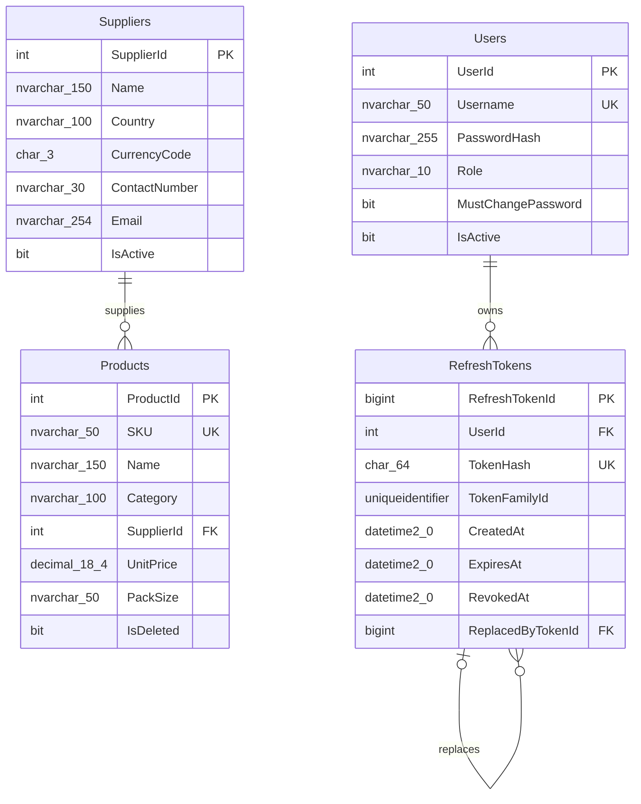

# Database design

This document reflects `database/schema/001_create_tables.sql`. Types and names are SQL Server definitions.

## Entity relationship diagram

`UK` marks unique constraints: `UQ_Users_Username`, `UQ_Products_SKU`, and `UQ_RefreshTokens_TokenHash`. `PK_*` constraints are primary keys. `RefreshTokens.ReplacedByTokenId` is nullable and references another token row.

## Table reference

### `dbo.Users`

Stores login identities and authorization state. `UserId INT IDENTITY` is the primary key. `Username NVARCHAR(50)` is required and unique. `PasswordHash NVARCHAR(255)` stores the ASP.NET Core Identity password hash. `Role NVARCHAR(10)` is constrained to `Admin` or `User`. `MustChangePassword` defaults to false and `IsActive` defaults to true. Deactivation is represented by `IsActive = 0`, not row deletion. No email or profile fields are defined.

### `dbo.Suppliers`

Stores supplier contact and pricing-currency metadata. `SupplierId INT IDENTITY` is the primary key. Name, country, `CurrencyCode CHAR(3)`, contact number, and email are required. `IsActive` defaults to true. No supplier-name or email unique constraint is defined. Deactivation preserves the supplier and product relationships; active-supplier queries filter on `IsActive = 1`.

### `dbo.Products`

Stores catalogue products. `ProductId INT IDENTITY` is the primary key. Required columns are `SKU NVARCHAR(50)`, name, category, `SupplierId INT`, `UnitPrice DECIMAL(18,4)`, and pack size. SKU is unique across the table, including soft-deleted rows. `SupplierId` references `dbo.Suppliers(SupplierId)`. `UnitPrice` has a check constraint `>= 0`. `IsDeleted` defaults to false; product deletion sets this flag, and list/detail/update SQL excludes deleted rows. The SKU unique constraint includes deleted rows.

### `dbo.RefreshTokens`

Stores refresh-token lifecycle data. `RefreshTokenId BIGINT IDENTITY` is the primary key. `UserId INT` references Users. `TokenHash CHAR(64)` is unique; token plaintext is not stored by the application. `TokenFamilyId UNIQUEIDENTIFIER` groups rotated tokens. `CreatedAt DATETIME2(0)` defaults to `SYSUTCDATETIME()`, `ExpiresAt DATETIME2(0)` is required, and nullable `RevokedAt` records revocation. Nullable `ReplacedByTokenId BIGINT` self-references `RefreshTokenId`. A check constraint requires `ExpiresAt > CreatedAt`. Revocation and replacement are lifecycle state, not row deletion.

## Constraints and relationships

| Name | Definition | Effect |
|---|---|---|
| `PK_Users`, `PK_Suppliers`, `PK_Products`, `PK_RefreshTokens` | Primary key on each identity column | Unique row identifiers; SQL Server backs them with unique indexes. |
| `UQ_Users_Username` | Unique `Users.Username` | Enforces unique usernames and supports username lookup. |
| `UQ_Products_SKU` | Unique `Products.SKU` | Prevents duplicate SKU values. |
| `UQ_RefreshTokens_TokenHash` | Unique `RefreshTokens.TokenHash` | Prevents duplicate stored token hashes. |
| `FK_Products_Suppliers` | Product to Supplier | Each product references one supplier; a supplier can have zero or more products. |
| `FK_RefreshTokens_Users` | RefreshToken to User | Each token belongs to one user; a user can have zero or more tokens. |
| `FK_RefreshTokens_ReplacedBy` | RefreshToken self-reference | A token can optionally point to its replacement. |
| `CK_Users_Role` | Role in `('Admin', 'User')` | Restricts persisted role values. |
| `CK_Products_UnitPrice` | `UnitPrice >= 0` | Prevents negative stored prices. |
| `CK_RefreshTokens_Expiry` | `ExpiresAt > CreatedAt` | Requires a positive token lifetime. |

The relationships follow the foreign keys in the schema. The SQL does not declare cascade delete behavior.

## Index inventory

Primary-key and unique-constraint indexes are listed above. The schema additionally declares:

| Index | Definition | Query pattern supported |
|---|---|---|
| `IX_Products_Active_Supplier_Category` | `(SupplierId, Category) INCLUDE (SKU, Name, UnitPrice, PackSize) WHERE IsDeleted = 0` | Supports active product filtering by supplier/category and covers selected product columns. |
| `IX_RefreshTokens_UserId_FamilyId` | `(UserId, TokenFamilyId)` | Supports refresh-token family operations scoped to a user. |
| `IX_RefreshTokens_ExpiresAt` | `(ExpiresAt)` | Supports expiration-based token maintenance/lookups where used. |

SQL Server also creates indexes for primary keys and unique constraints. No explicit index is defined for supplier name, product name/category sorting, or active users. `usp_Products_GetPaged` searches name and SKU with leading wildcards; the supplied schema does not declare a text-search index for those predicates. These are observations, not recommendations or proof of a particular query plan.

## Stored procedure catalog

Repositories in `backend/Repositories` pass parameters through Dapper with `CommandType.StoredProcedure`; no repository embeds SQL text. `ProductRepository.GetPagedAsync` uses `QueryMultipleAsync` because the procedure returns a count result followed by page rows. Procedures centralize data operations and some actor checks/status results. C# services/controllers handle password hashing, JWT issuance, DTO validation, and response mapping.

### Authentication and refresh tokens — `database/procedures/001_authentication.sql`

| Procedure | SQL responsibility |
|---|---|
| `dbo.usp_Users_GetByUsername` | Reads login user fields by username. |
| `dbo.usp_Users_ChangePassword` | Updates an active user's password hash, clears `MustChangePassword`, and returns affected-row count. |
| `dbo.usp_RefreshTokens_Create` | Persists a token hash, family, and expiry for a user. |
| `dbo.usp_RefreshTokens_Rotate` | Validates and rotates a refresh token in a transaction, creating a replacement and linking/revoking lifecycle state. |
| `dbo.usp_RefreshTokens_RevokeCurrent` | Revokes the token/family identified by the supplied hash according to procedure logic. |
| `dbo.usp_RefreshTokens_RevokeAllForUser` | Revokes refresh tokens for a user. |

### User management — scripts `002`, `005`, `006`, and `007`

| Procedure | SQL responsibility |
|---|---|
| `dbo.usp_Users_Create` | Creates a user after declared actor/input checks. |
| `dbo.usp_Users_GetAll` | Returns user-list fields. |
| `dbo.usp_Users_Update` | Updates user management fields subject to declared checks. |
| `dbo.usp_Users_ResetPassword` | Stores supplied reset hash and sets password-change state according to SQL. |
| `dbo.usp_Users_Activate` | Activates a user according to its actor checks. |
| `dbo.usp_Users_Deactivate` | Deactivates a user and applies procedure safeguards/token revocation. |
| `dbo.usp_Users_BootstrapFirstAdmin` | Transactionally inserts the first Admin only when Users is empty; sets forced password change. |
| `dbo.usp_Users_GetById` | Returns user fields, including hash and account/password-change state, by ID. |
| `dbo.usp_Users_ChangePassword` | Updates an active user's password hash and clears the forced-change flag. |

The same `dbo.usp_Users_ChangePassword` name is defined in `001_authentication.sql` and `007_change_password.sql` using `CREATE OR ALTER`; applying the latter later replaces the former definition.

### Supplier management — `database/procedures/003_supplier_management.sql`

| Procedure | SQL responsibility |
|---|---|
| `dbo.usp_Suppliers_GetAll` | Lists active and inactive suppliers ordered by name. |
| `dbo.usp_Suppliers_GetActive` | Lists active suppliers ordered by name. |
| `dbo.usp_Suppliers_Create` | Checks active Admin and nonblank details, normalizes text/currency case, inserts active supplier. |
| `dbo.usp_Suppliers_Update` | Checks active Admin and nonblank details, then updates supplier details. |
| `dbo.usp_Suppliers_Deactivate` | Sets `IsActive = 0` after active Admin check. |
| `dbo.usp_Suppliers_Reactivate` | Sets `IsActive = 1` after active Admin check. |

### Product management — `database/procedures/004_product_management.sql`

| Procedure | SQL responsibility |
|---|---|
| `dbo.usp_Products_GetPaged` | Validates page/sort arguments; filters nondeleted products by search/supplier/category; returns count and sorted page, joined to supplier data. |
| `dbo.usp_Products_GetById` | Returns one nondeleted product joined to supplier. |
| `dbo.usp_Products_Create` | Checks active actor, nonblank values, nonnegative price, active supplier, and inserts. SKU uniqueness is enforced by the schema. |
| `dbo.usp_Products_Update` | Checks active actor and supplier, updates a nondeleted product, returns status. |
| `dbo.usp_Products_SoftDelete` | Requires active Admin and sets `IsDeleted = 1`. |

## Other design decisions

- Product soft deletion preserves the row and SKU reservation. List/detail/update/delete procedures operate on `IsDeleted = 0` records.
- Supplier deactivation preserves the supplier and existing products. Product create/update require an active supplier.
- Password hashes are generated with ASP.NET Core Identity `PasswordHasher<LoginUser>` in `AuthService`; SQL stores the supplied hash and does not hash passwords.
- Refresh-token rows store hashes and family/replacement/revocation metadata. `AuthController` sends the plaintext token only as an HttpOnly cookie.
- Supplier currency is a required `CHAR(3)` code. Product `UnitPrice DECIMAL(18,4)` is interpreted in supplier currency; LKR equivalents/rates are response values computed by the API and are not stored in Products.
- SQL constraints cover selected invariants; API DTO validation adds request lengths/formats/ranges. No unique constraint is defined for supplier names or emails.

## Installation scope and verification

This document describes checked-in SQL scripts, not a live database catalog. Apply schema before procedures and seed data as directed in the root [README](../README.md). End-to-end verification against the target SQL Server remains environment-dependent.
